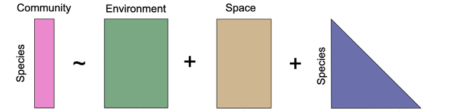
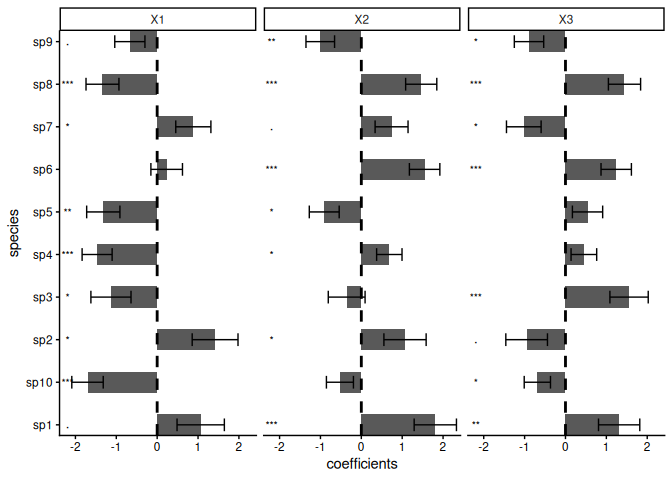
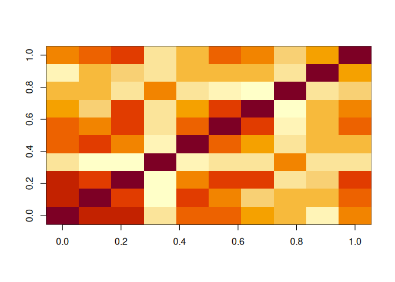
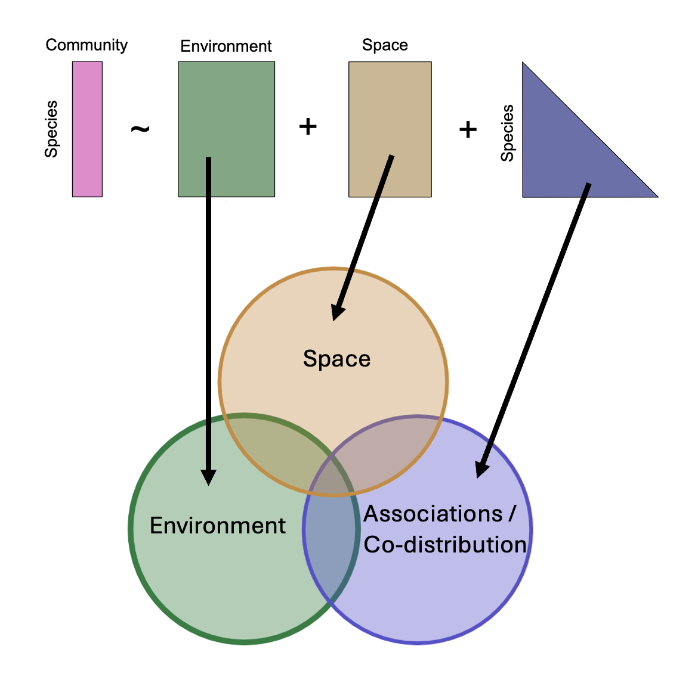
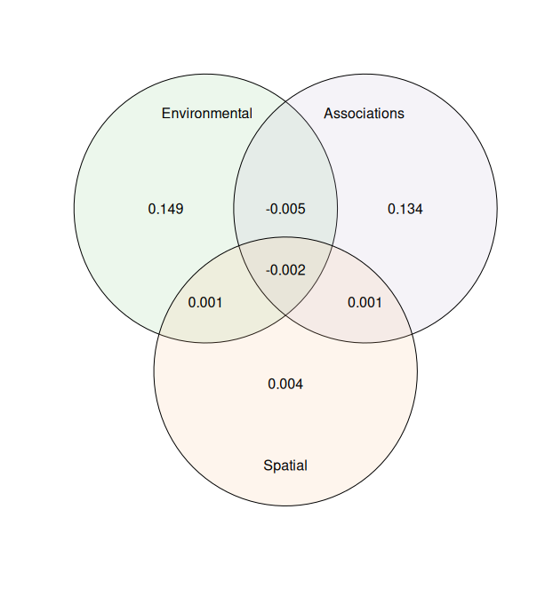
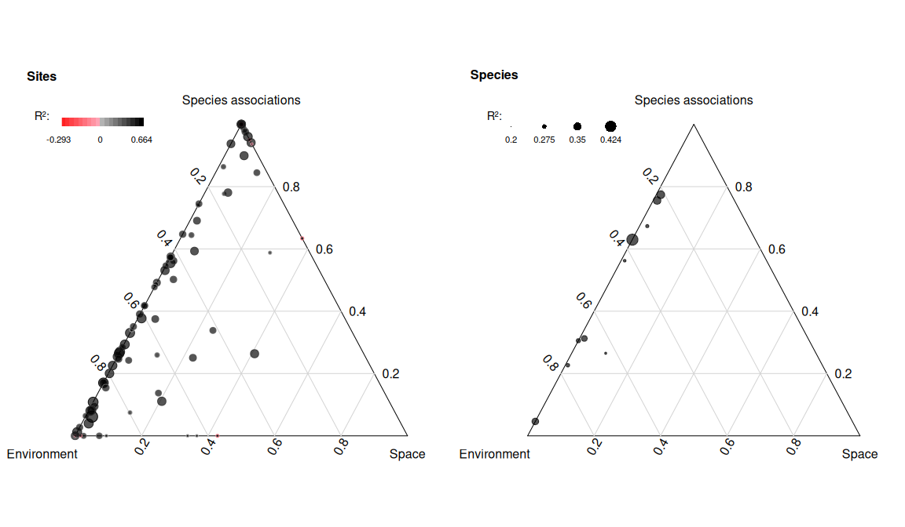
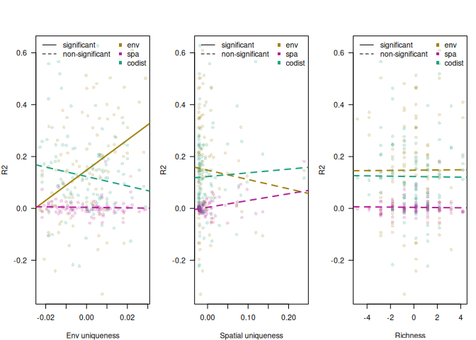

<!-- README.md is generated from README.Rmd. Please edit that file -->

[](http://www.repostatus.org/#active)
[](https://www.gnu.org/licenses/gpl-3.0)
[](https://cran.r-project.org/package=sjSDM)

[](https://doi.org/10.1111/2041-210X.13687)

# s-jSDM - Fast and accurate Joint Species Distribution Modeling

## About sjSDM

The sjSDM package is an R package for estimating joint species
distribution models. A jSDM is a GLMM that models a multivariate (i.e. a
many-species) response to the environment, space and a covariance term
that models conditional (on the other terms) correlations between the
outputs (i.e. species).

<figure>

<figcaption aria-hidden="true">image</figcaption>
</figure>

A big challenge in jSDM implementation is computational speed. The goal
of the sjSDM (which stands for “scalable joint species distribution
models”) is to make jSDM computations fast and scalable. Unlike many
other packages, which use a latent-variable approximation to make
estimating jSDMs faster, sjSDM fits a full covariance matrix in the
likelihood, which is, however, numerically approximated via simulations.
The method is described in Pichler & Hartig (2021) A new joint species
distribution model for faster and more accurate inference of species
associations from big community data,
<https://doi.org/10.1111/2041-210X.13687>.

Since version 1.1.0 the core code of sjSDM is implemented in R on top of
[torch](https://torch.mlverse.org/) (libtorch). Earlier versions wrapped
a Python / PyTorch backend through reticulate; that is gone, and with it
the need for python, conda and a separate PyTorch installation. Model
code runs unchanged, but results differ from 1.0.x: the default
optimizer is now `Adam()` (`sjSDMControl(optimizer = RMSprop())`
restores the old one), `predict()` returns marginal predictions, and
`anova()` and `Rsquared()` results change because several defects were
fixed. See `news(package = "sjSDM")`.

To get citation info for sjSDM when you use it for your reseach, type

``` r
citation("sjSDM")
```

## Installing the R package

sjSDM is distributed via
[CRAN](https://cran.rstudio.com/web/packages/sjSDM/index.html). For most
users, it will be best to install the package from CRAN

``` r
install.packages("sjSDM")
```

The only dependency that is not an ordinary R package is the libtorch
binary, which `torch` downloads on first use. If that has not happened
yet, run

``` r
sjSDM::install_sjSDM()   # wrapper around torch::install_torch()
```

There is no separate CPU and GPU build any more: whether the GPU can be
used follows from the `torch` installation
(`torch::cuda_is_available()`, or `torch::backends_mps_is_available()`
on Apple silicon). Pass `device = "gpu"` or `device = "mps"` to
`sjSDM()` to use it.

For advanced users: if you want to install the current (development)
version from this repository, run

``` r
devtools::install_github("https://github.com/TheoreticalEcology/s-jSDM", subdir = "sjSDM", ref = "master")
```

If the installation fails, check out the help of ?install_sjSDM and
?installation_help.

1.  Run `sjSDM::install_diagnostic()` and check whether libtorch is
    installed
2.  If not, run `torch::install_torch()` and restart R
3.  If you still do not get the pkg to run, create an issue on the
    [issue tracker](https://github.com/TheoreticalEcology/s-jSDM/issues)
    or write an email to maximilian.pichler at ur.de

## Basic Workflow

Load the package

``` r
library(sjSDM)
```

Simulate some community data

``` r
set.seed(42)
community <- simulate_SDM(sites = 100, species = 10, env = 3)
Env <- community$env_weights
Occ <- community$response
SP <- matrix(rnorm(200, 0, 0.3), 100, 2) # spatial coordinates (no effect on species occurences)
```

This fits the standard SDM with environmental, spatial and covariance
terms

``` r
model <- sjSDM(Y = Occ, env = linear(data = Env, formula = ~X1+X2+X3), spatial = linear(data = SP, formula = ~0+X1:X2), se = TRUE, family=binomial("probit"), sampling = 100L, verbose = FALSE)
```

``` r
summary(model)
```

    ## Family:  binomial 
    ## 
    ## LogLik:  -497.2144 
    ## Regularization loss:  0 
    ## 
    ## Species-species correlation matrix: 
    ## 
    ##  sp1  1.0000                                 
    ##  sp2  0.6820  1.0000                             
    ##  sp3  0.6730  0.5890  1.0000                         
    ##  sp4 -0.2840 -0.4660 -0.4360  1.0000                     
    ##  sp5  0.4090  0.5100  0.2880 -0.4000  1.0000                 
    ##  sp6  0.4020  0.3400  0.5710 -0.2850  0.3540  1.0000             
    ##  sp7  0.1360 -0.0520  0.4840 -0.2290  0.0950  0.5180  1.0000         
    ##  sp8  0.0410  0.0520 -0.2300  0.2600 -0.2730 -0.4100 -0.5610  1.0000     
    ##  sp9 -0.4050 -0.0030 -0.0850 -0.2170  0.0430  0.0400  0.0520 -0.2240  1.0000 
    ##  sp10     0.3360  0.4290  0.5850 -0.2930  0.0450  0.3740  0.2800 -0.0860  0.1390  1.0000
    ## 
    ## 
    ## 
    ## Spatial: 
    ##             sp1        sp2       sp3       sp4       sp5      sp6      sp7
    ## X1:X2 0.3514133 -0.8500652 -1.957628 0.5300332 0.7929875 1.074655 1.609042
    ##            sp8       sp9      sp10
    ## X1:X2 0.450536 -2.314983 0.4139834
    ## 
    ## 
    ## 
    ##                  Estimate Std.Err Z value Pr(>|z|)    
    ## sp1 (Intercept)   -0.2027  0.3024   -0.67  0.50262    
    ## sp1 X1             1.0651  0.5788    1.84  0.06573 .  
    ## sp1 X2             1.8100  0.5174    3.50  0.00047 ***
    ## sp1 X3             1.3130  0.5048    2.60  0.00929 ** 
    ## sp2 (Intercept)   -0.5442  0.2949   -1.84  0.06504 .  
    ## sp2 X1             1.4173  0.5605    2.53  0.01145 *  
    ## sp2 X2             1.0692  0.5166    2.07  0.03846 *  
    ## sp2 X3            -0.9501  0.5094   -1.87  0.06217 .  
    ## sp3 (Intercept)   -0.1459  0.2686   -0.54  0.58710    
    ## sp3 X1            -1.1306  0.4906   -2.30  0.02119 *  
    ## sp3 X2            -0.3583  0.4502   -0.80  0.42610    
    ## sp3 X3             1.5558  0.4687    3.32  0.00090 ***
    ## sp4 (Intercept)    0.3756  0.1839    2.04  0.04107 *  
    ## sp4 X1            -1.4691  0.3672   -4.00  6.3e-05 ***
    ## sp4 X2             0.6849  0.3107    2.20  0.02751 *  
    ## sp4 X3             0.4500  0.3135    1.44  0.15118    
    ## sp5 (Intercept)   -0.5160  0.2164   -2.38  0.01712 *  
    ## sp5 X1            -1.3180  0.4068   -3.24  0.00120 ** 
    ## sp5 X2            -0.9073  0.3657   -2.48  0.01310 *  
    ## sp5 X3             0.5397  0.3702    1.46  0.14484    
    ## sp6 (Intercept)    0.1168  0.2045    0.57  0.56797    
    ## sp6 X1             0.2329  0.3865    0.60  0.54673    
    ## sp6 X2             1.5486  0.3726    4.16  3.2e-05 ***
    ## sp6 X3             1.2412  0.3717    3.34  0.00084 ***
    ## sp7 (Intercept)    0.0194  0.2353    0.08  0.93412    
    ## sp7 X1             0.8847  0.4299    2.06  0.03961 *  
    ## sp7 X2             0.7401  0.4029    1.84  0.06624 .  
    ## sp7 X3            -1.0197  0.4238   -2.41  0.01611 *  
    ## sp8 (Intercept)    0.2507  0.2069    1.21  0.22575    
    ## sp8 X1            -1.3380  0.4027   -3.32  0.00089 ***
    ## sp8 X2             1.4653  0.3811    3.85  0.00012 ***
    ## sp8 X3             1.4441  0.3938    3.67  0.00025 ***
    ## sp9 (Intercept)   -0.0981  0.2004   -0.49  0.62454    
    ## sp9 X1            -0.6684  0.3691   -1.81  0.07016 .  
    ## sp9 X2            -1.0043  0.3498   -2.87  0.00409 ** 
    ## sp9 X3            -0.8923  0.3593   -2.48  0.01301 *  
    ## sp10 (Intercept)   0.0723  0.1908    0.38  0.70476    
    ## sp10 X1           -1.7041  0.3845   -4.43  9.3e-06 ***
    ## sp10 X2           -0.5234  0.3306   -1.58  0.11332    
    ## sp10 X3           -0.6881  0.3213   -2.14  0.03221 *  
    ## ---
    ## Signif. codes:  0 '***' 0.001 '**' 0.01 '*' 0.05 '.' 0.1 ' ' 1

Plot the niche estimates, i.e the estimates in the environmental
component:

``` r
plot(model)
```

    ## Warning: Using `size` aesthetic for lines was deprecated in ggplot2 3.4.0.
    ## ℹ Please use `linewidth` instead.
    ## ℹ The deprecated feature was likely used in the sjSDM package.
    ##   Please report the issue at
    ##   <https://github.com/TheoreticalEcology/s-jSDM/issues>.
    ## This warning is displayed once per session.
    ## Call `lifecycle::last_lifecycle_warnings()` to see where this warning was
    ## generated.

<!-- -->

Visualize the species-species association matrix

``` r
image(getCor(model))
```

<!-- -->

## Conditional predictions

Because the model estimates how species co-occur, knowing which species
occur at a site informs the prediction of the others. Set the species to
predict to `NA` in `Y`; all `NA` cells of a site are then predicted
together, in one pass, conditional on the observed species of that site:

``` r
Occ_new = Occ
Occ_new[, 1:3] = NA
pred_cond = predict(model, newdata = Env, SP = SP, Y = Occ_new)
head(round(pred_cond, 3))
```

    ##       [,1]  [,2]  [,3]
    ## [1,] 0.354 0.559 0.512
    ## [2,] 0.105 0.187 0.195
    ## [3,] 0.140 0.317 0.024
    ## [4,] 0.495 0.168 0.325
    ## [5,] 0.540 0.307 0.600
    ## [6,] 0.810 0.555 0.675

## Grouping factors (random effects)

Sites that share a plot, a transect or a year are not independent.
Grouping factors are written into the environmental formula with the bar
syntax of ‘lme4’; without them, a shared plot effect would be absorbed
by the species associations. Here 20 plots of 5 sites each, with an
unmeasured plot condition that some species like and others avoid:

``` r
plot_id = factor(rep(1:20, each = 5))
plot_condition = rnorm(20)[plot_id]
eta = as.matrix(Env) %*% matrix(rnorm(30), 3, 10) + outer(plot_condition, runif(10, -1.5, 1.5))
Occ_plot = 1 * (eta + rnorm(1000) > 0)
Env_plot = data.frame(Env, plot = plot_id)
```

``` r
model_plot = sjSDM(Y = Occ_plot, env = linear(Env_plot, ~ X1 + X2 + X3 + (1 | plot)), verbose = FALSE)
```

``` r
summary(model_plot)
```

    ## Family:  binomial 
    ## 
    ## LogLik:  -404.7378 
    ## Regularization loss:  0 
    ## 
    ## Species-species correlation matrix: 
    ## 
    ##  sp1  1.0000                                 
    ##  sp2 -0.1520  1.0000                             
    ##  sp3 -0.1950 -0.0840  1.0000                         
    ##  sp4 -0.1760 -0.0250  0.0840  1.0000                     
    ##  sp5 -0.0310  0.1010  0.2530 -0.1060  1.0000                 
    ##  sp6 -0.2060  0.0550  0.1810  0.1710 -0.0060  1.0000             
    ##  sp7  0.1510 -0.1590  0.2400 -0.1830  0.0750 -0.1110  1.0000         
    ##  sp8  0.2920 -0.0400 -0.0800 -0.1880  0.1270 -0.1820  0.0960  1.0000     
    ##  sp9  0.1040 -0.2980  0.0840  0.0310  0.0270 -0.0330 -0.0150  0.1160  1.0000 
    ##  sp10     0.0680  0.0180 -0.4020  0.1090 -0.2040 -0.0120 -0.3460  0.0850  0.0520  1.0000
    ## 
    ## 
    ## 
    ## Random effects, Lambda Lambda' averaged over species: 
    ## ((Intercept) | plot), 20 levels, df = 5
    ##        [,1]
    ## [1,] 0.7054
    ## 
    ## 
    ## Coefficients (beta): 
    ## 
    ##                    sp1        sp2         sp3         sp4        sp5        sp6
    ## (Intercept)  0.2490749 -0.3154065  0.01233485  0.35998818  0.2507245 -0.2524475
    ## X1          -0.6653624  0.4896335 -0.66320634 -0.51954395  0.2024549  1.8847468
    ## X2           1.3013539  0.1343983 -0.64209729 -0.02628958 -2.2741477 -3.0058999
    ## X3           0.9826373  1.5270293 -0.03340935  0.73602736  0.9497439  1.6304603
    ##                     sp7         sp8         sp9       sp10
    ## (Intercept)  0.58012366  0.02156327  0.08291961 -0.1639894
    ## X1           1.26444364  1.26629651  2.27439070  2.4240963
    ## X2           1.40901816  0.61337990  0.91030324  1.4323016
    ## X3          -0.01848988 -0.05529701 -0.52407610  0.2576420

`getRE()` returns the estimated group covariance and the predicted group
effects, and `anova()` reports the variation partitioning conditional on
the grouping, together with what the grouping alone explains.

## Anova / Variation partitioning

### Global ANOVA

As in other models, it can be interesting to analyze how much variation
is explained by which parts of the model.

{{width=70%}} For the Env,
Spatial, Covariance terms, this is implemented in

``` r
an = anova(model, verbose = FALSE)
```

``` r
summary(an)
```

    ## Analysis of Deviance Table
    ## 
    ##                Deviance Residual deviance R2 Nagelkerke R2 McFadden
    ## Abiotic      1.9813e+02        1.1747e+03    8.6211e-01      0.1443
    ## Associations 1.8424e+02        1.1886e+03    8.4156e-01      0.1342
    ## Spatial      6.0126e+00        1.3669e+03    5.8355e-02      0.0044
    ## Full         3.8838e+02        9.8449e+02    9.7943e-01      0.2829

``` r
plot(an)
```

<!-- -->

The anova shows the relative changes in the R<sup>2</sup> of the groups
and their intersections.

### Internal metacommunity structure

Following [Leibold et al., 2022](https://doi.org/10.1111/oik.08618) we
can calculate and visualize the internal metacommunity structure
(=partitioning of the three components for species and sites). The
internal structure is already calculated by the ANOVA and we can
visualize it with the plot method:

``` r
results = internalStructure(an)
```

The internal structure can be plotted:

``` r
plot(results)
```

<!-- -->

Which can be regressed against covariates to analyse assembly processes:

``` r
plotAssemblyEffects(results)
```

<!-- -->
